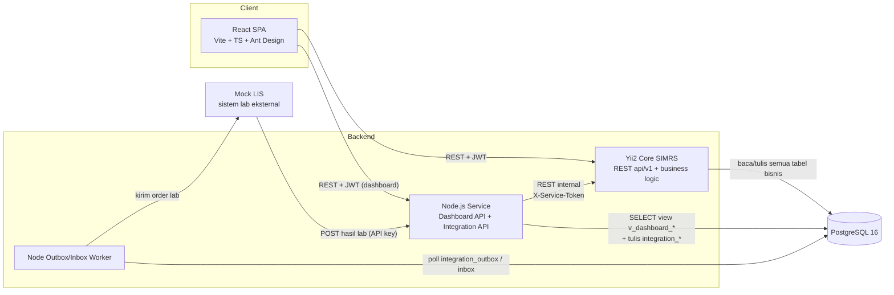
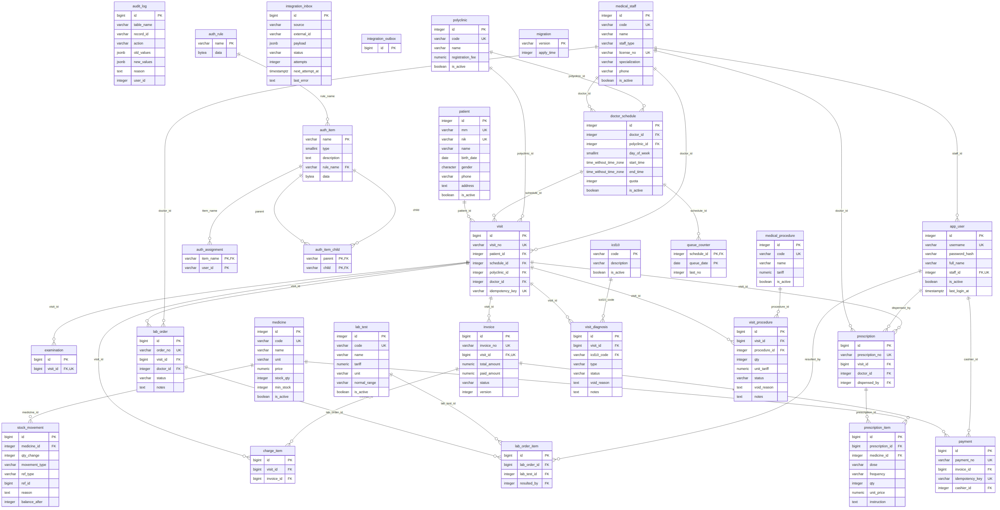
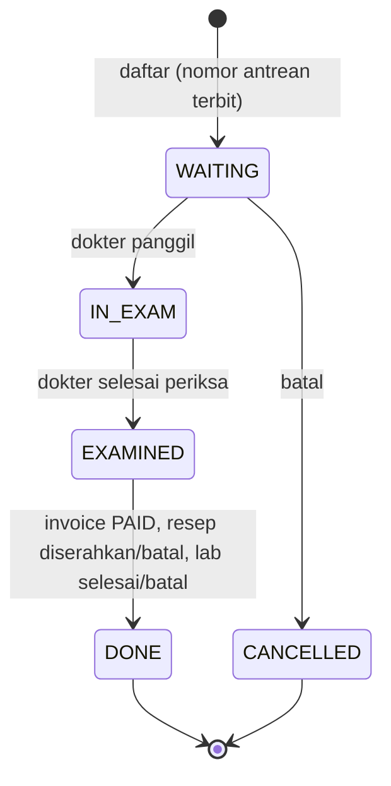

# 01 — Arsitektur

## 1. Gambaran

SIMRS rawat jalan: pendaftaran → pemeriksaan → tindakan → laboratorium → farmasi → billing → pembayaran, dengan hak akses 6 peran. Tiga aplikasi dan satu database, semua dijalankan satu perintah `docker compose up -d --build`.

| Komponen | Teknologi | Peran |
| -------- | --------- | ----- |
| `frontend-react/` | React 18 + TypeScript + Vite, Ant Design 5, TanStack Query, Recharts | Satu SPA untuk semua modul termasuk master data |
| `backend-yii/` | Yii2 (API-only, PHP 8.3), PostgreSQL | **Core SIMRS**: semua business logic dan transaksi, penerbit JWT, RBAC |
| `service-node/` | Node.js 20, Express, zod, pg, pino | **Service integrasi + dashboard**: API dashboard, integrasi lab eksternal (outbox/inbox), middleware auth/validasi |
| PostgreSQL 16 | — | Satu database; skema **hanya** dimiliki migration Yii |

## 2. Diagram komponen



Di mode pengembangan, browser hanya mengenal satu origin (Vite, `:5173`) yang mem-proxy `/yii/*` ke Yii dan `/node/*` ke Node.

## 3. Pembagian tanggung jawab Yii vs Node.js

Aturan inti: **semua perubahan data bisnis hanya lewat service Yii**. Node tidak pernah menulis tabel bisnis.

| Aspek | Yii2 (Core) | Node.js (Service) |
| ----- | ----------- | ----------------- |
| Peran | Pemilik business logic & transaksi | Integrasi eksternal + agregasi dashboard |
| Tulis data | Semua tabel bisnis (pasien, kunjungan, RM, resep, stok, tagihan, bayar) | Hanya `integration_outbox` dan `integration_inbox` |
| Baca data | Semua | View `v_dashboard_*` + tabel integration |
| Skema DB | Pemilik migration | Tidak ada |
| Auth | Login, terbit JWT RS256, RBAC (`DbManager`) | Verifikasi JWT (public key) + `requireRole`; API key untuk sistem eksternal |
| Hasil lab eksternal | `LabService::recordResult()` — satu-satunya logika simpan hasil | Terima, validasi format, simpan ke inbox, teruskan ke endpoint internal Yii |
| Order lab keluar | Tulis event ke outbox dalam transaksi yang sama dengan order | Worker baca outbox, kirim, retry backoff |
| Dashboard | — | Endpoint agregat (jumlah, pendapatan, rekap) dengan cache 60 dtk |

Penegakan **di database**, bukan sekadar konvensi (migration `m261114_100800_grant_service_role`):

* Role `simrs_core` (Yii): pemilik skema, DML semua tabel.
* Role `simrs_service` (Node): `SELECT` hanya pada 5 view `v_dashboard_*`; `INSERT/UPDATE` hanya `integration_inbox` dan `integration_outbox`. Upaya menulis tabel bisnis → `permission denied`.
* Definisi "kunjungan", "pendapatan", dst. berada di **satu** view SQL (`m261114_100700_create_dashboard_views`) → Node tidak menduplikasi rumus.

## 4. Struktur modul

```text
backend-yii/
  modules/api/v1/controllers/   # tipis: validasi + panggil service
  services/                     # RegistrationService, VisitService, ExaminationService, PharmacyService,
                                # LabService, InvoiceService, PaymentService, StockService, PdfService, AuditService
  components/                   # JwtService, ApiResponse, ApiException/ApiErrorHandler, BaseMasterController, DbErrors
  models/                       # ActiveRecord master data + ExaminationForm
  migrations/                   # satu-satunya sumber skema (9 migration)
service-node/src/
  routes/ middlewares/ repositories/ services/ lib/
frontend-react/src/
  api/ auth/ components/ (MasterCrudPage generik) features/{master,visits,billing,dashboard} pages/
```

Prinsip: controller tipis, business logic di service layer, satu pemilik logika per proses (mis. status invoice hanya dihitung `InvoiceService::statusFor`).

## 5. Model data

30 tabel + 5 view (`database/schema.sql`, hasil `pg_dump --schema-only`). ERD: `database/erd.png` (sumber Mermaid: `docs/erd.mmd`, dibangkitkan dari database oleh `scripts/gen-erd.py`).



| Kelompok | Tabel | Constraint kunci |
| -------- | ----- | ---------------- |
| Auth | `app_user`, `auth_item`, `auth_item_child`, `auth_assignment`, `auth_rule` | `username` UNIQUE; 1 akun per staf |
| Master | `patient`, `medical_staff`, `polyclinic`, `doctor_schedule`, `medical_procedure`, `medicine`, `lab_test`, `icd10` | `mrn`/`nik` UNIQUE; `doctor_schedule` `EXCLUDE USING gist` (dokter, hari, rentang jam) → tidak ada jadwal bentrok; `medicine.stock_qty CHECK (>= 0)`; trigram index nama pasien |
| Pendaftaran | `visit`, `queue_counter` | UNIQUE (`schedule_id`,`visit_date`,`queue_no`); UNIQUE parsial satu kunjungan aktif per pasien/poli/hari; `idempotency_key` UNIQUE |
| Rekam medis | `examination`, `visit_diagnosis`, `visit_procedure` | UNIQUE parsial satu diagnosis utama aktif per kunjungan; ubah = VOID + alasan (tidak ada hapus fisik) |
| Farmasi | `prescription`, `prescription_item`, `stock_movement` | Ledger stok `stock_movement` (tanda +/−, `balance_after`) |
| Lab | `lab_order`, `lab_order_item` | Tarif disimpan sebagai snapshot |
| Billing | `invoice`, `charge_item`, `payment` | `invoice.visit_id` UNIQUE; `charge_item` UNIQUE parsial (`source_type`,`source_id`) saat ACTIVE; `payment.idempotency_key` UNIQUE; uang `NUMERIC(14,2)` |
| Audit & integrasi | `audit_log`, `integration_outbox`, `integration_inbox` | `audit_log` nilai lama/baru JSONB + alasan; inbox UNIQUE (`source`,`external_id`) |
| Laporan | `v_dashboard_visit_daily`, `_procedure_daily`, `_revenue_daily`, `_medicine_daily`, `_invoice_status` | Agregat harian; filter periode = rentang pada kolom tanggal |

### Status kunjungan



Status invoice: `UNPAID` → `PARTIAL` → `PAID`; `OVERPAID` hanya bila total turun di bawah jumlah yang sudah dibayar (skenario D-4).

## 6. Hak akses (RBAC)

| Fitur | Admin | Pendaftaran | Dokter | Farmasi | Lab | Kasir |
| ----- | :---: | :---------: | :----: | :-----: | :-: | :---: |
| Master data | CRUD | Pasien CRU | R | Obat R + penyesuaian stok | Lab test R | R |
| Pendaftaran & antrean | R | CRU | R | — | — | R |
| Pemeriksaan, diagnosis, tindakan | R | — | CRU (pasien sendiri) | — | — | — |
| Resep | R | — | C | R + serah | — | — |
| Order & hasil lab | R | — | C + R hasil | — | R + input hasil | — |
| Billing & pembayaran | R | — | — | — | — | CRU |
| Dashboard | semua widget | — | — | — | — | hanya pendapatan & status bayar |
| Pengguna & peran | CRUD | — | — | — | — | — |

Dokter hanya melihat dan mengubah kunjungan miliknya (rule RBAC `isOwnVisit`: `visit.doctor_id = user.staff_id`). Penegakan tiga lapis: menu React (UX), `can()` di controller Yii, `requireRole` di Node.
